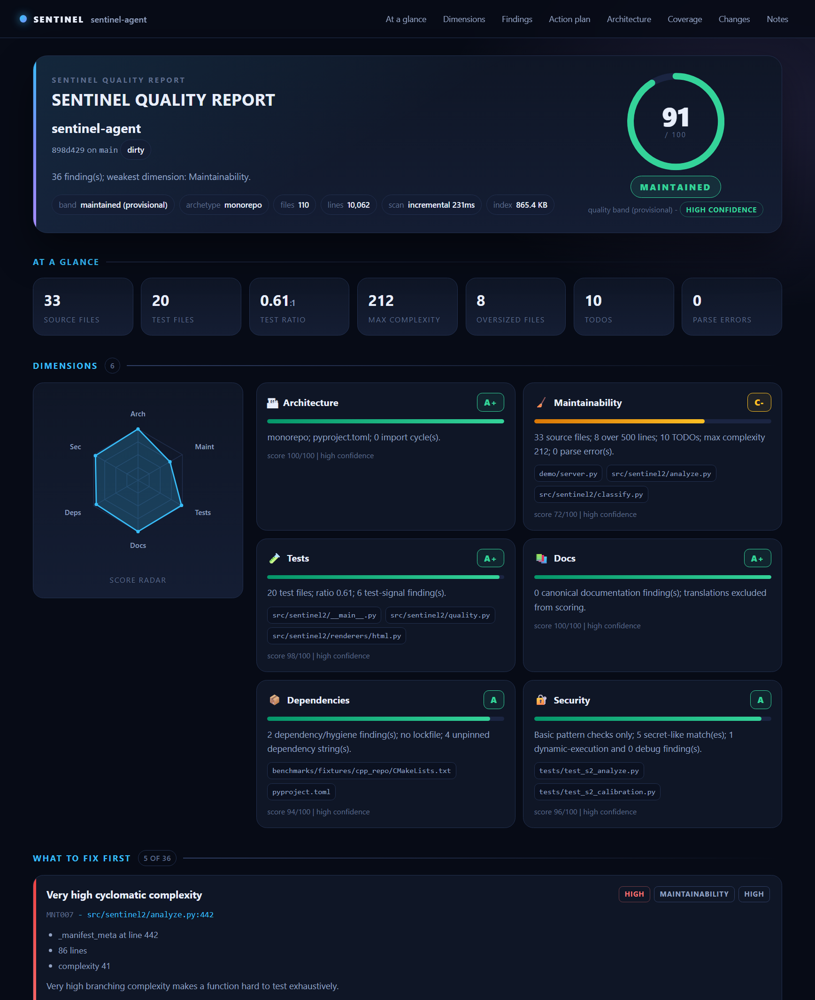

# Sentinel 2.0

**One command. One page. Live repository quality with evidence.**

[](https://github.com/Ntooxx/Sentinel/actions/workflows/test.yml)
[](https://ntooxx.github.io/Sentinel/)
[](#install)
[](pyproject.toml)

Sentinel reads a repository, builds a fast incremental index, and produces a concise quality report with the source risks that matter. Run it once in CI, or keep it live while refactoring.

```text
project-sentinel scan  <path>    # build/update the index and print the report
project-sentinel report <path>   # render from the index without rescanning
project-sentinel watch  <path>   # keep the index and report live
```

Sentinel 2.0 is intentionally focused: three commands, one SQLite index, one report object, zero runtime dependencies.

**Local. Free. Fast.** No account, no upload, no API key, no telemetry, no per-report cost.

| | |
|---|---|
| **Local** | your code never leaves the machine. A local folder path works fully offline. |
| **Free** | Apache-2.0 with zero runtime dependencies, so there is nothing to meter or bill. |
| **Fast** | warm scan of a 1,228-file repository in **0.34 s**; report from the index in **0.11 s**. |

That is the trade against hosted paste-a-repo services: you give up a hosted convenience and get a scan that is instant, private, and unmetered.

## See it

This is a real report on this repository, rendered from Sentinel's own self-contained HTML output — one file, inline CSS, no server:



**Live version:** <https://ntooxx.github.io/Sentinel/> — rebuilt by CI on every push, so the published page is the report for the current commit. The machine-readable output is there too: `report.json` and `report.md`.

Regenerate it with `project-sentinel report . --open`, or write it to a file with
`project-sentinel scan . --format html --out report.html`. The committed artifact is
[`docs/demo/sentinel-report.html`](docs/demo/sentinel-report.html); open it in a browser. It is produced by
[`tools/capture_screenshots.ps1`](tools/capture_screenshots.ps1).

### Try it on any repository

Don't want to install anything to see the output? There is a zero-dependency web demo:

```bash
python demo/server.py --open
```

Paste a repository URL (`https://github.com/psf/requests`, or the `psf/requests`
shorthand) or a local folder path, and the demo clones it, runs the real scan, and
shows the report. It is a thin harness over the same `scan_project` and
`render_html` the CLI uses - no mock data and no pre-computed results - and it
never executes the code it clones.

Pasting a URL and getting the report takes about **3 seconds** for a typical
repository (`psf/requests`: clone ~2.9 s, scan ~0.5 s); a local folder path skips
the clone entirely. The demo runs **local-only by default** and ships with
deploy configs ([`render.yaml`](render.yaml), [`fly.toml`](fly.toml),
[`demo/Dockerfile`](demo/Dockerfile)) for hosting it as a web service with
`--public` limits. Full guide: [`docs/DEMO.md`](docs/DEMO.md).

## Why this version exists

The 1.x line tried to be a dashboard, an MCP server, a retrieval engine, a memory store, and a scanner at once. Sentinel 2.0 keeps the part that is useful and makes it fast and trustworthy:

- source-first analysis, so documentation translations and vendored files do not dominate the report;
- an incremental SQLite index instead of a 400+ MB JSON checkpoint;
- a top-5 report with evidence and a recommendation for each finding;
- a live HTML report updated by polling, with no server, WebSocket, telemetry, or cloud service;
- one implementation used by the CLI, the installed entry point, and tests.

## Install

Requires Python 3.10+.

```bash
python -m pip install .
project-sentinel --version
```

From a checkout without installing:

```bash
python sentinel.py --version
# or, from the repository root:
PYTHONPATH=src python -m sentinel2 --version
# Windows PowerShell:
$env:PYTHONPATH='src'; python -m sentinel2 --version
```

`python sentinel.py` is a compatibility launcher for the same `sentinel2.cli:main` entry point and adds `src/` to the path automatically.

## Quick start

```bash
project-sentinel scan .
project-sentinel report . --format md --out sentinel-report.md
project-sentinel watch . --out .sentinel/quality.html
```

The first scan builds `.sentinel/quality.db`. Later scans reuse unchanged file facts and only analyse what changed.

## Commands and flags

### scan

```text
project-sentinel scan [PATH]
  --format text|md|html|json   Output format. Default: text.
  --out PATH                   Write output to a file.
  --full                       Re-analyse all source files fully; no fast sampling.
  --include-docs               Read documentation content, not only metadata.
  --all-findings               Print all findings, not only the top 5.
  --fail-under BAND            Exit 3 if the quality band is below maintained/adequate/weak.
  --ignore PATH                Repeatable; exclude a project-relative path.
  --no-color                   Disable ANSI color.
  --quiet                      Suppress logs and progress.
```

### report

```text
project-sentinel report [PATH]
  --format text|md|html|json
  --out PATH
  --open                       Open the HTML report in the default browser.
  --refresh                    Run a scan first, then render.
```

`report` reads the latest scan snapshot from SQLite. It does not rescan, rebuild ASTs, or modify the index.

### watch

```text
project-sentinel watch [PATH]
  --format text|html|md|json   Default: html.
  --out PATH                   Default: .sentinel/quality.html
  --interval SECONDS           Default: 1.0
  --debounce MILLISECONDS      Default: 300
  --include-docs
  --full
  --quiet
```

Watch mode polls for changes, re-analyses only changed paths, and writes the report atomically. The HTML file is self-contained and uses a small meta refresh so a browser can follow it without a local server.

## Exit codes

| Code | Meaning |
|---:|---|
| 0 | Success |
| 1 | Runtime error, invalid path, unreadable index, or no index for `report` |
| 2 | Invalid CLI usage |
| 3 | Quality gate failed (`--fail-under`) |

## What the report answers

Every report states:

1. what the repository is;
2. how healthy the assessed dimensions are;
3. the top source risks, with file/line evidence and a recommendation;
4. what changed since the previous scan;
5. what to do next;
6. what was read, sampled, skipped, excluded, and what the confidence level means.

The JSON report is the stable contract; text, Markdown, and HTML are renderings of the same object. JSON includes every finding, even when the terminal report shows only the top five.

### Dimensions

Sentinel scores six dimensions with initial weights:

| Dimension | Weight | Measures |
|---|---:|---|
| Architecture | 20% | entry points, components, import cycles, public surface |
| Maintainability | 25% | file/function size, complexity, TODOs, parse errors |
| Tests | 20% | test presence, static test mapping, ratio, hotspot signals |
| Documentation | 15% | README, canonical docs, placeholders, broken relative links |
| Dependencies | 10% | manifests, lockfiles, pinning, license, ignore/CI files |
| Security | 10% | basic secret and dangerous-pattern checks only |

If a dimension is not assessed it is shown as `n/a` and excluded from the weighted score. Documentation translations, examples, generated files, and vendor trees are excluded from source quality. Test mapping is **static evidence** that a test imports or names a module; it is not runtime coverage.

The overall result is a coarse **quality band** — `maintained`, `adequate`, `weak` or `unmaintained` — not a letter grade. Five of the six dimensions saturate near A+ on maintained code, so a fine overall grade was manufacturing resolution the evidence does not contain; the band is the claim the analysis can defend. Letter grades are still shown per dimension as evidence. The findings list is the primary output: it names what to fix first. The band is marked **provisional**. The rubric is calibrated against a corpus of fifteen real repositories with a reproducible harness (`tools/calibrate.py`), and its measured agreement is recorded in [`docs/CALIBRATION.md`](docs/CALIBRATION.md). The `(provisional)` marker disappears only once that calibration passes its acceptance criteria and `calibrated` is set in the rules. Security is explicitly a basic pattern check, not a security audit.

## Performance

Measured on Windows 11, Python 3.11, warm OS cache, FastAPI source + tests:

| Workload | Measured |
|---|---:|
| Cold scan (963 text files, 184 skipped binaries) | ~1.9 s |
| Warm scan, no changes | ~0.3 s |
| Report from SQLite | ~0.15 s |
| Index for that tree | ~4 MB |
| Synthetic 10k cold / warm | ~5.3 s / ~0.8 s |
| Synthetic 25k cold / warm | ~13.3 s / ~1.9 s |
| Index for 25k files | ~45 MB |

These are local measurements, not promises. The release budgets are in [`sentinel_2.md`](sentinel_2.md).

Budgets and failure handling are documented in [`sentinel_2.md`](sentinel_2.md). The benchmark harness is in [`tools/benchmark.py`](tools/benchmark.py):

```bash
python tools/gen_repo.py --files 10000 --out .tmp/repo-10k
python tools/benchmark.py --repo .tmp/repo-10k --mode all --json
```

## Privacy and safety

- Local only. No network calls, telemetry, uploads, or remote logging during scan/report/watch.
- No third-party runtime dependencies.
- Repository paths are project-relative in reports.
- Secret-like matches are redacted in every output format.
- HTML escapes all repository-controlled strings.
- `.sentinel/` is ignored by discovery.
- Symlinks are not followed; binary and oversized files are skipped with a recorded reason.

See [`docs/PRIVACY_AND_SAFETY.md`](docs/PRIVACY_AND_SAFETY.md).

## Development

```bash
python -m pytest -q -m "not perf"
python -m pytest -q -m perf
ruff check .
python -m compileall -q src
```

The tests exercise the real CLI and the `sentinel2` package. The retired 1.x code lives under [`legacy/`](legacy) — excluded from linting and from the scan, preserved in full, and still runnable with `python -m pytest legacy/tests`. The active package does not import it.

## Documentation

- [`docs/USER_GUIDE.md`](docs/USER_GUIDE.md) - scan/report/watch, formats, CI usage
- [`docs/DEMO.md`](docs/DEMO.md) - the web demo: usage, speed, and deploying it
- [`docs/API.md`](docs/API.md) - Python helpers and JSON report contract
- [`docs/ARCHITECTURE.md`](docs/ARCHITECTURE.md) - index, incremental scan, quality model
- [`docs/CALIBRATION.md`](docs/CALIBRATION.md) - how the rubric is calibrated against real repositories, and how well it agrees with review
- [`docs/PRIVACY_AND_SAFETY.md`](docs/PRIVACY_AND_SAFETY.md) - local-only design and basic security checks
- [`docs/report.schema.json`](docs/report.schema.json) - JSON Schema for report v2
- [`docs/DESIGN_DECISIONS.md`](docs/DESIGN_DECISIONS.md) - why the tool is shaped this way, including what was built and removed
- [`sentinel_2.md`](sentinel_2.md) - the implementation blueprint and acceptance criteria
- [`CHANGELOG.md`](CHANGELOG.md) - 2.0.0 breaking change

## License

Apache-2.0. See [`LICENSE`](LICENSE).
